# MetarMap2

A Raspberry Pi turns a wall map into a live weather display: an LED at each airport shows its current conditions from
[aviationweather.gov](https://aviationweather.gov) (VFR green, MVFR blue, IFR red, LIFR purple, and more). An
optional small OLED screen cycles through the details for the airports you pick, and a web UI lets you control and
set up the map from your phone.

Written from the ground up with a web UI, an API and a Home Assistant integration (see [Credits](#credits)).

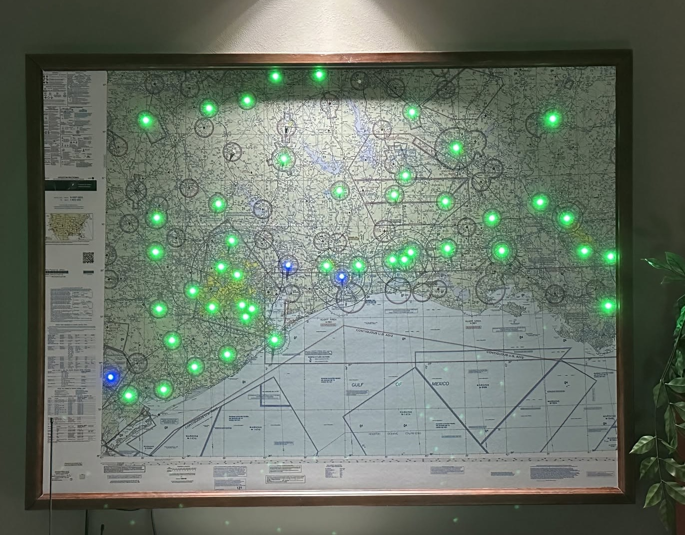

## Features

- **Visualizers**: show the flight category, wind, wind gusts, wind direction, temperature, pressure, precipitation,
  visibility, density altitude, ceiling, dewpoint spread (fog risk), AIRMETs and SIGMETs (the advisory over each
  airport: IFR, mountain obscuration, turbulence, wind shear, strong wind or icing, and SIGMETs such as
  thunderstorms blinking on top) or TFRs (temporary flight restrictions in or near each airport, by type) on the
  LEDs, plus Rainbow and Chase patterns.
  Switch between them on the web UI, or let the map rotate through them.
- **Lightning**: airports reporting lightning or a thunderstorm flicker yellow or white (a double flash every 2 s) in every weather visualizer, unless you turn the animation off in Config.
- **Estimated flight categories**: a station that doesn't report its flight category, but does report its visibility
  or clouds, gets an estimate from them. Its LED breathes slowly so you can tell, and the OLED shows it with a `*`
  (`VFR*`).
- **Dimming by time of day**: the LEDs dim at sunset, go nearly dark at dusk, dim again at dawn and are back to full
  brightness at sunrise, using the sun times for your city.
- **OLED screen** (optional): wind, visibility, pressure, temperature, dewpoint and report time for each airport you
  choose, with that airport's LED pulsing while it's shown.
- **Web UI**: current conditions, a METAR list, a live map that mirrors the LEDs and the OLED screen, and settings.
  Click an airport on the map for its weather in plain English, its raw METAR, or the METAR decoded line by line.
  The map can go fullscreen, and follows the visualizer as it changes. Tick **Live traffic** to see the aircraft
  around your airports; click one for its details and the map follows it. Update and restart the map from the Home
  page. `/remote` is a remote control for a tablet in kiosk mode.
- **API and Home Assistant**: everything in the web UI also works over HTTP (see [API.md](API.md)); the
  [metarmap2_ha](https://github.com/dman776/metarmap2_ha) integration adds the map to Home Assistant.
- **A touchscreen remote** (optional): [metarmap2_remote](https://github.com/dman776/metarmap2_remote) is firmware for
  a small ESP32-S3 touch display that sits beside the map and works like the `/remote` page.

## Screenshots

### The map page

The Map page mirrors the LEDs, with a copy of the OLED screen, over an FAA chart, satellite imagery or live radar.

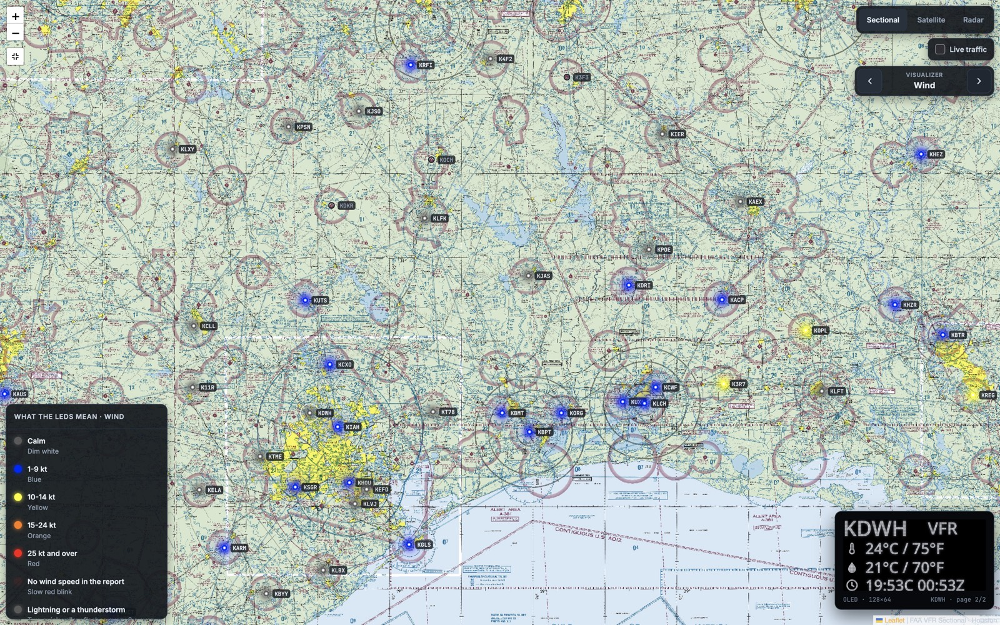

The Wind Direction visualizer, with wind barbs, over the radar background:

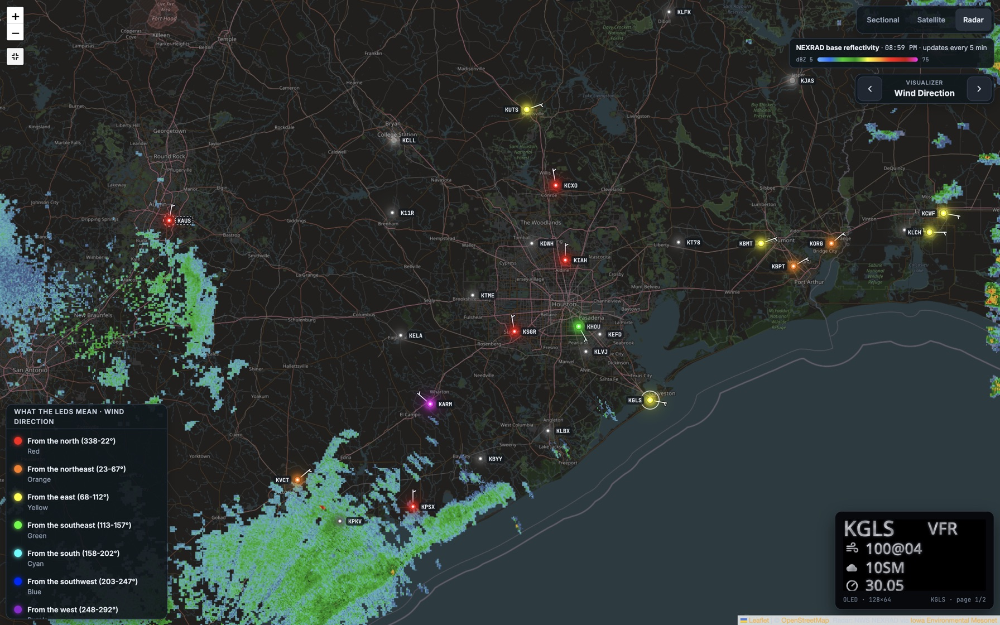

Click an airport for its weather in plain English, the raw METAR, or the METAR decoded line by line:

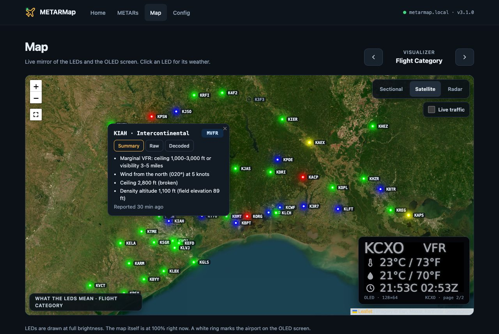

### Live traffic

Tick **Live traffic** to see the aircraft around your airports from [adsb.fi](https://adsb.fi/), each icon sized and
colored by the class of aircraft (light, small, large, heavy, helicopter...).

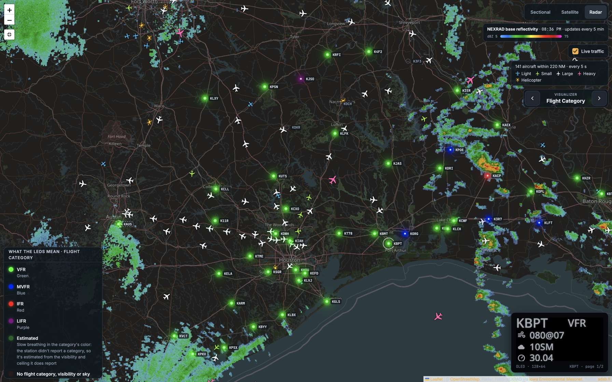

Click an aircraft for its details; the map follows it and draws its trail.

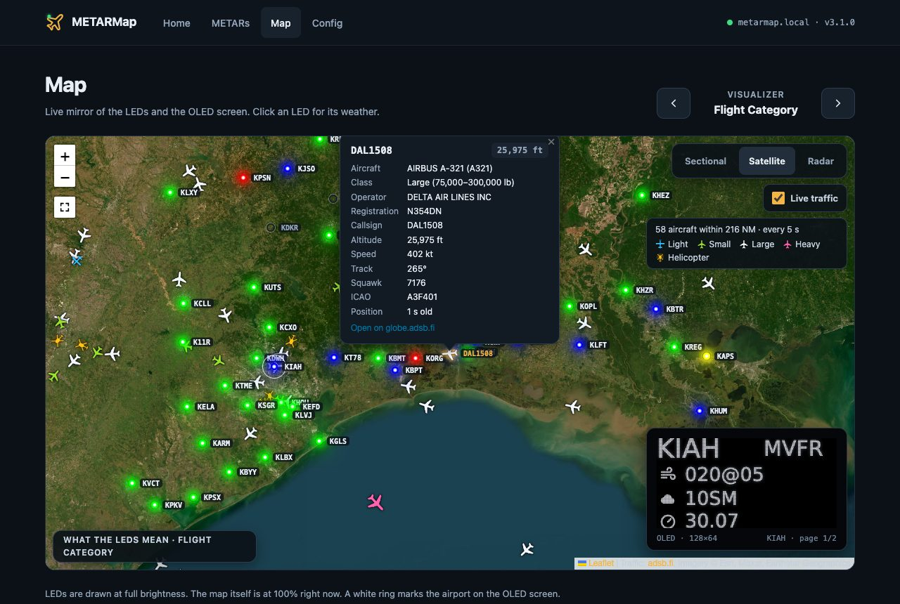

### Home and METARs

The Home page has the map's status, the visualizer and its legend, brightness and the OLED switch, and the airports
that are below VFR. The METARs page lists every airport's report.

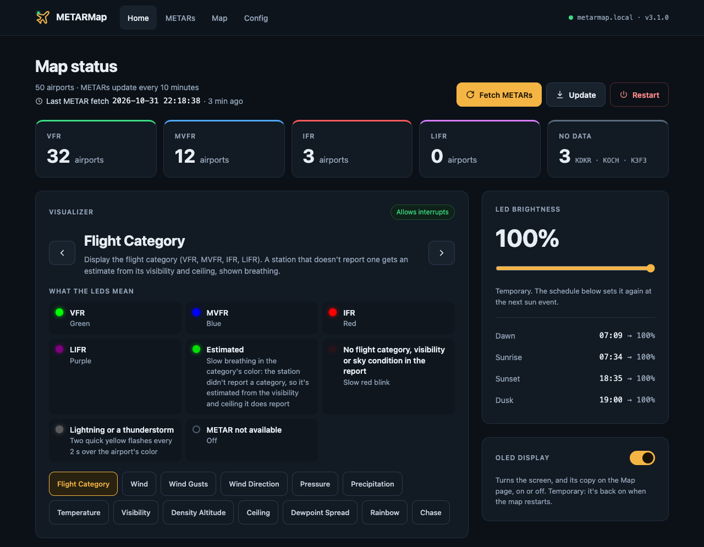

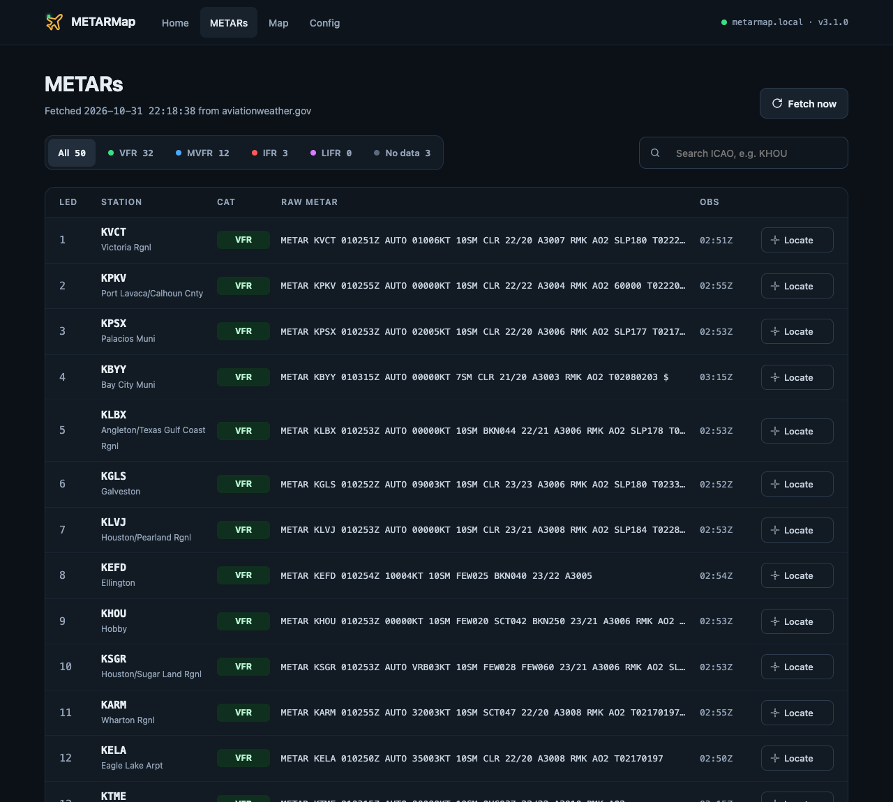

### Config

Settings save as you change them.

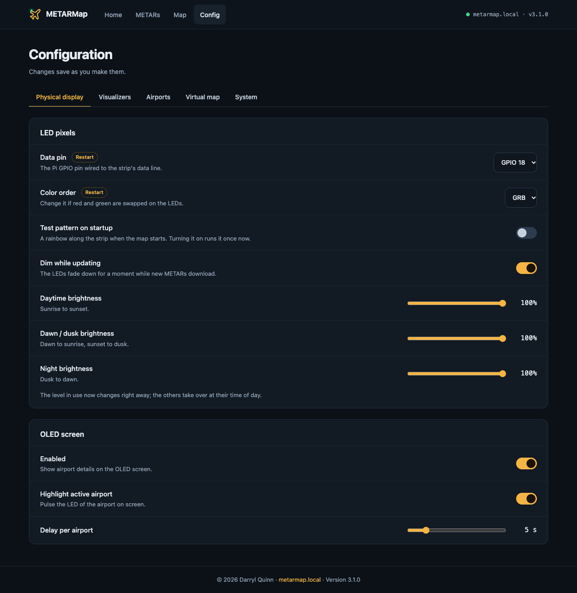

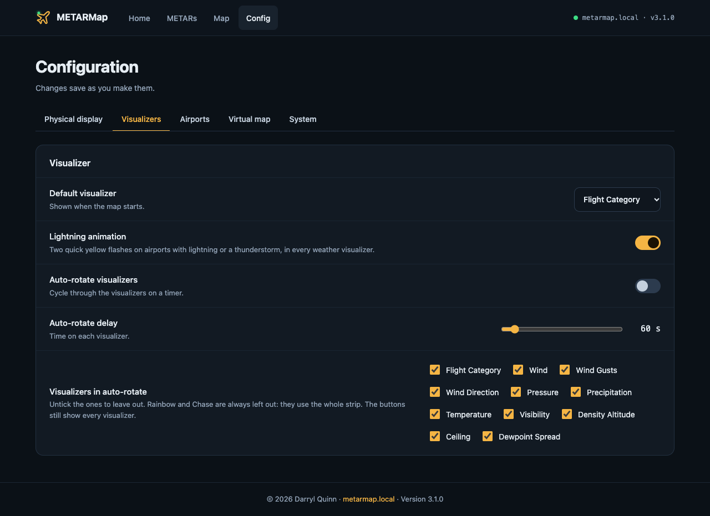

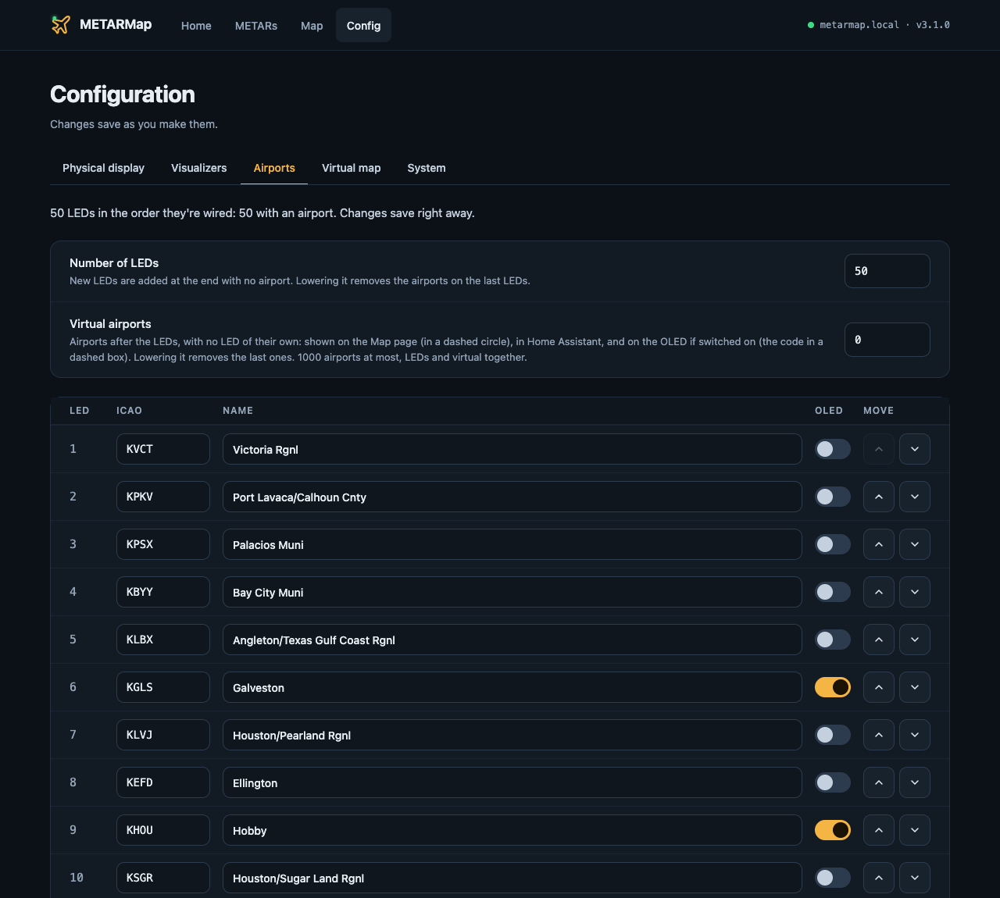

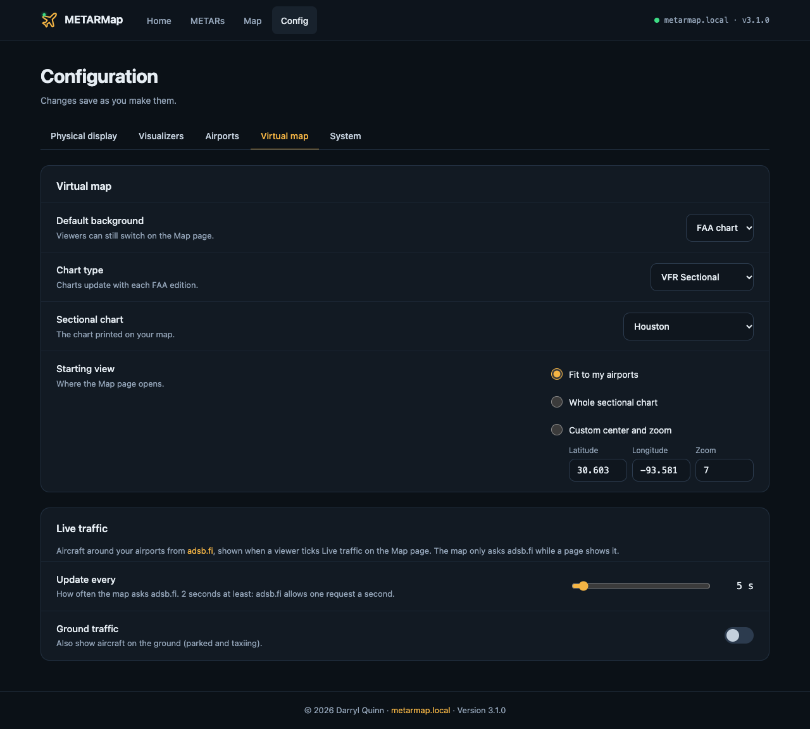

### Remote control

`/remote` is a remote control for a tablet in kiosk mode, here on an iPad in landscape: pick a visualizer, or, on the
**Info** tab, press an airport to find its LED (**Locate**), or, with spoken weather on, to hear its **AWOS** or
**ATIS**.

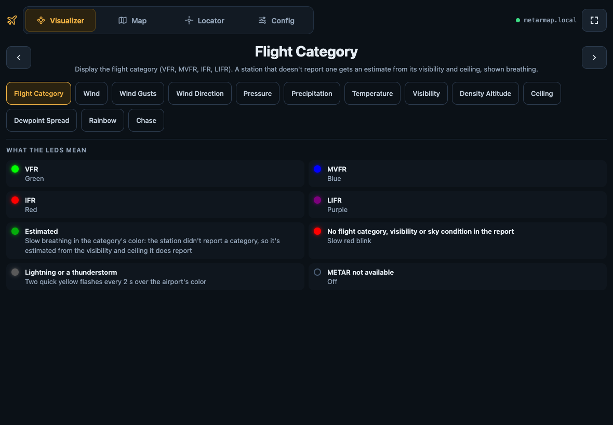

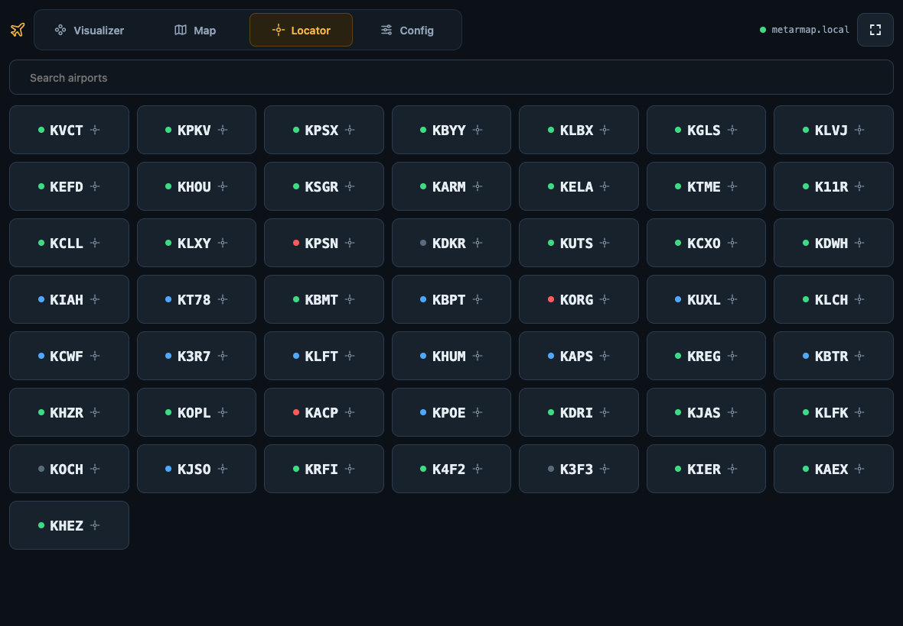

For a dedicated screen instead of a tablet, [metarmap2_remote](https://github.com/dman776/metarmap2_remote) is a
companion project: firmware for a 2.8" ESP32-S3 touchscreen (the LCDwiki ES3C28P) with the same Visualizer and Locator
screens, which updates itself from GitHub releases.

## What you need

- A Raspberry Pi with Wi-Fi (a Zero W, 3, 4 or 5) and a microSD card
- A strip or string of WS2811/WS2812 ("NeoPixel") LEDs, one per airport, and a 5V power supply big enough for them
- A map, and a frame or board to mount it and the LEDs
- Optional: a 128x64 SSD1306 I2C OLED screen

Wiring:

- **LEDs**: data to GPIO 18 (pin 12), ground to a Pi ground, power from the 5V supply. GPIO 12, 13, 21 or 10 also
  work: pick it in Config > Physical display > LED pixels. See Adafruit's
  [NeoPixels on Raspberry Pi](https://learn.adafruit.com/neopixels-on-raspberry-pi/raspberry-pi-wiring) guide.
- **OLED screen**: SDA to GPIO 2 (pin 3), SCL to GPIO 3 (pin 5), VCC to 3.3V, GND to ground.

The original project's write-ups cover the build in detail:
[making the map](https://slingtsi.rueker.com/making-a-led-powered-metar-map-for-your-wall/) and
[adding the display](https://slingtsi.rueker.com/adding-a-mini-display-to-show-metar-information-to-the-metar-map/).

## Try it on your computer

You don't need a Raspberry Pi, LEDs or an OLED screen to try MetarMap2. On your own computer it runs with in-memory
stand-ins for the LED strip and the screen, and the web UI works as it does on a Pi, with live METARs: the Map page
shows each airport's LED, colors and effects included, over an FAA chart, and a copy of the OLED screen.

These steps are for macOS or Linux, with Python 3.9 or newer and git installed.

1. Download the map and install what it needs:

   ```sh
   git clone https://github.com/dman776/metarmap2
   cd metarmap2
   python3 -m venv .venv
   .venv/bin/pip install -e .
   ```

2. Start it on port 8080 (the map's own port, 80, usually needs `sudo` on a computer):

   ```sh
   .venv/bin/python -m metarmap --port 8080
   ```

   `--port` is for that run only; `config.json` keeps its port, so you can copy the folder to a Pi as it is.

3. Open http://localhost:8080. The first METARs arrive within a few seconds. The Config pages ask for the login in
   `config.json` (`metar` / `map` to start).

It starts with the 50 example airports around Houston; change them on **Config > Airports**. Settings are saved in
the `config.json` of the folder you start it from, and the log is `metarmap.log` in the same folder (warnings and
errors also show in the terminal). Settings for the hardware, such as the LED data pin, are saved but have nothing to drive. Stop the map with Ctrl-C.

## Install

1. With [Raspberry Pi Imager](https://www.raspberrypi.com/software/), write **Raspberry Pi OS Lite** to the microSD
   card. In Imager's settings, set:
   - a hostname, such as `metarmap`
   - a user name and password
   - your Wi-Fi network
   - your time zone (the map dims at your local sunset and sunrise)
   - SSH turned on
2. Put the card in the Pi, power it up, and wait a minute or two for it to join your Wi-Fi.
3. Connect to it from your computer with `ssh pi@metarmap.local`, using your hostname and user name.
4. Install git, download the map and run the installer:

   ```sh
   sudo apt update && sudo apt install -y git
   git clone https://github.com/dman776/metarmap2
   cd metarmap2
   ./install.sh
   ```

   The installer sets up everything the map needs and asks for:
   - a user name and password for the web UI's settings pages
   - your city, for the sunrise and sunset times (a larger city nearby works too)

   It installs the newest **release** (a tagged version), not the newest commit, which may be unfinished, then
   starts the map and prints its web address. Installing takes a few minutes, longer on a Pi Zero. Running
   `./install.sh` again is safe; it keeps your settings, and leaves a folder that's already on a release (one you
   picked yourself) where it is. To install the newest commit instead, for testing, use `./install.sh --latest`.
5. Open the web address, go to **Config > Airports**, and set up your airports (next section).

## Setting up your airports

On **Config > Airports**:

1. Set **Number of LEDs** to the number of LEDs on your strip, then restart the map when it asks. (Without a
   strip, the web map changes right away.)
2. Enter the ICAO code (such as `KDFW`) of the airport at each LED, in the order the LEDs are wired, starting
   from the one nearest the Pi. Leave a code empty for an LED that isn't at an airport.
3. Turn on **OLED** for the airports you want on the screen. Each airport's name fills itself in; change it if
   you like (an emptied name fills in again).
4. Use the up and down arrows to move an airport to another LED; the others shift along.

Changes save right away. To check the wiring order:
- Choose the **Chase** visualizer on the Home page, which lights each LED in turn.
- Or use the locate button next to an airport on the **METARs** page, which pulses that airport's LED.

## Settings

**Config** has the rest of the settings:
- the default visualizer and auto-rotate, including which visualizers it shows
- whether an airport blinks red when its report lacks what the visualizer shows (**Missing data blink**, on by
  default), or stays dark
- whether an estimated flight category breathes or shows a steady color (**Estimated flight category breathing**, on
  by default)
- whether the legends list only what the LEDs are showing now (**Only show legend items in use**, off by
  default)
- lightning: the animation on or off, and its color (yellow or white)
- the OLED screen
- the map page's chart
- the LED brightness for day, dawn and dusk, and night
- optional **Quiet hours** with local start/end times (0% physical LED brightness during the interval);
  Home shows one quiet-hours row and mutes sun events that fall within the window
- whether the LEDs fade down for a moment while new METARs download (**Dim while updating**, on by default)

Every setting takes effect right away; none needs a restart.

**Config > System > Access** changes:
- the web UI login. On a Raspberry Pi, the new password also becomes the password of the Pi's login user
  (e.g. `pi`), so you don't have two to remember. On any other machine only the web UI login changes.
- the Wi-Fi network. The Pi switches a few seconds after you save, and keeps the old network: if it can't join
  the new one, it goes back. To reach the map afterwards, put your phone or computer on the new network too.

Everything is saved in `config.json` in the `metarmap2` folder. To edit that file by hand, stop the map first
(`./stop.sh`), then start it again (`./start.sh`).

## Updating

The map checks GitHub for a new release when it starts and every 6 hours. When there is one, every page shows
**Update available** at the top, and the Home page's button reads **Update to v2.9.0** (for example). Click it, then
use **Restart**. Your `config.json` is kept.

**Config > System > Software** has more:
- **Check now** asks GitHub straight away.
- **Update to**: **Releases** (the default) installs only released versions, and never goes back to an older one.
  **Latest commit** installs the newest code on GitHub, released or not. Use it on a map you test changes on.
- **Install a release** installs any release, older ones too, to go back if a new one has a problem. It asks first
  before going back.

Or, over SSH, the newest release:

```sh
cd metarmap2
git fetch --tags
git checkout v2.9.0      # the release you want
./install.sh
```

Running `./install.sh` after an update also installs any new packages the map needs. On a map that has installed a
release, `git pull` says it isn't on a branch: `git checkout master` first (or pick **Latest commit** above).

## Spoken weather

The map can read an airport's METAR aloud, as an AWOS does: an **AWOS** button beside each airport on the METARs
page, an **AWOS** mode on the Remote page's Info tab, and `http://metarmap.local/api/speak/KHOU.audio` for anything
else (`/api/speak/KHOU` shows the words). It's off until you turn it on. It's for fun, not for flight planning: listen
to the airport's own AWOS, ASOS or ATIS for that.

A speech server on another computer reads the reports; the map sends it the words and keeps the audio it gets back,
so even a Pi Zero W can do it. Two kinds work:
- **Piper in Home Assistant** (free, offline): install the **Piper** add-on, then in **Settings > Add-ons > Piper >
  Configuration > Network** set the port to `10200` and save (add-ons don't open their ports to your network until
  you do). The map talks to it over the Wyoming protocol, as Home Assistant does; any
  [wyoming-piper](https://github.com/rhasspy/wyoming-piper) server works the same way.
- **[Kokoro](https://github.com/remsky/Kokoro-FastAPI)** (Kokoro-FastAPI, free, runs on your own computer): its
  address and port, e.g. `http://192.168.0.164:8880`.

Then on the map: **Config > System > Spoken weather**, turn on **Enable speech**, pick the server and fill in its
address. **Test** plays the first airport's report there and then, or says what's wrong.

The first time an airport is asked for, the server takes a few seconds to make its report; after that the map keeps
it until the next METAR, so playing it again is instant.

Settings (`speech` in `config.json`):
- `enabled`: spoken weather on or off (off by default; the rest is kept while it's off)
- `engine`: `wyoming` (Piper, e.g. Home Assistant's) or `kokoro`
- `wyoming_host`, `wyoming_port`, `wyoming_voice`: Home Assistant's address, `10200`, and a Piper voice such as
  `en_US-lessac-medium` or `en_US-ryan-high` (empty: the add-on's own; Home Assistant downloads a voice the first time
  it's asked for)
- `kokoro_url`, `kokoro_voice`, `kokoro_speed`: the Kokoro server, a voice such as `af_heart` or `bm_george`, and how
  fast it reads (0.5 to 2)

If `/api/speak/<code>.audio` answers with an error, it says why: speech is off, no server is set, the server can't be
reached (for Home Assistant, check the add-on's port), or the server's own reason, such as a voice it doesn't have.

### Spoken ATIS

About 75 large US airports publish their ATIS as text (the FAA's digital ATIS, D-ATIS). With **Spoken ATIS** on
(**Config > System > Spoken weather**, `speech.atis`), the map reads an airport's real ATIS aloud too, through the
same speech server: `http://metarmap.local/api/atis/KHOU.audio` (`/api/atis/KHOU` shows the words). Unlike the AWOS
it has the information letter, the approaches and runways in use, and the NOTAMs. An airport with separate arrival
and departure ATIS reads both, arrival first.

The text comes from [atis.info](https://atis.info), an unofficial copy of the FAA's D-ATIS with no published terms,
so it's off until you turn it on, and the map only asks it when someone plays an ATIS (at most once a minute, one
request for every airport) and every half hour to know which airports have one. The FAA writes ATIS in its
contractions ("DEPG RY 15L", "TWY EA CLSD"); the map writes those out as words ("departing runway one five left",
"taxiway Echo Alpha closed") so the voice reads them right. A contraction it doesn't know is read as it's written.

**Read along**: while an ATIS plays, the page shows it line by line, the FAA's text over how it's said, with the
line being said lit and kept in view: a way to learn to read a D-ATIS. On the Remote page's Info tab (ATIS mode)
under the airports, and on the METARs page in a panel at the bottom (× closes it and stops the audio). The voice
doesn't say when it reaches each line, so the map works it out from the lines' lengths: close, not exact.

**Pronunciation** (**Config > System > Spoken weather > Pronunciation**, `speech.tunings`): your own words for what
the map doesn't say well, such as a fix or a local name (`MNSTR` said "monster"), a typo in the FAA's text
(`GRO UND` said "ground"), or a word you'd rather hear another way (`RNAV` said "are nav"), for every airport or one.
Each is matched as whole words, in any case, before the map's own rules, and is said exactly as you write it. The
page lists the words in your airports' ATIS now that the map reads as written (press one to tune it), and **Try it**
shows and plays an airport's ATIS with your tunings.

Like the spoken weather, it's for fun, not for flight planning.

## Web API, Home Assistant and the touchscreen remote

`GET /api/status` returns the map's state as JSON. The web UI's controls are plain HTTP requests too, so scripts and
home automation can use them. See **[API.md](API.md)** for every endpoint.

```sh
curl http://metarmap.local/api/status                            # current state (JSON)
curl http://metarmap.local/brightness/0.25                       # set LED brightness
curl http://metarmap.local/visualizer/next                       # next visualizer
curl -u metar:map http://metarmap.local/config/edit/lightning.animation/false
```

The [metarmap2_ha](https://github.com/dman776/metarmap2_ha) custom integration controls the map from Home Assistant
through this API. It provides:
- a brightness light and a visualizer selector
- fetch and restart buttons
- config switches and numbers
- flight-category sensors
- a `metarmap.locate` action

The [metarmap2_remote](https://github.com/dman776/metarmap2_remote) firmware uses the same API from a small touchscreen
on your network: it reads `/api/live` and `/api/status`, and sends `/visualizer/...`, `/brightness/...` and
`/locate/...`. It doesn't need the map's username and password.

## Troubleshooting

- **Is it running?** `systemctl status metarmap`. Start and stop it with `./start.sh` and `./stop.sh`.
- **What happened?** The map's log is `metarmap.log` in the `metarmap2` folder (older ones are `metarmap.log.1`,
  `.2`, ...). Problems are marked `WARNING` or `ERROR` (`grep -E "WARNING|ERROR" metarmap.log`), and those, with
  crashes, also go to `journalctl -u metarmap`.
- **LEDs stay dark or show the wrong colors**:
  1. Check the data wire goes to the pin set in Config > Physical display > LED pixels (GPIO 18 unless you changed it) and that the
     strip shares a ground with the Pi.
  2. Run a test pattern: choose the **Chase** visualizer on the Home page (it lights each LED in turn), or turn on
     **Startup sequence** in Config > Physical display (turning it on plays it along the strip once, right away).
  3. If red and green are swapped, change **Color order** in Config > Physical display > LED pixels (GRB or RGB) and restart.
- **OLED screen stays blank**: `sudo i2cdetect -y 1` should show the screen at address `3c`. If it shows nothing,
  check the wiring, and that I2C is on (`sudo raspi-config`, Interface Options).
- **An airport's LED is off**: it hasn't reported in the last 5 hours, or its code is wrong. The METARs page shows
  which airports have no data.

## Development

You can work on the map without a Raspberry Pi. With no LED strip or OLED screen, the map uses in-memory stand-ins,
and the web UI (including the live Map page and its OLED window) works as usual with real METARs.

- Set up: `uv sync --extra dev` (or `python3 -m venv .venv && .venv/bin/pip install -e ".[dev]"`)
- Run the tests: `.venv/bin/pytest`
- Check the code: `.venv/bin/ruff check .`
- Run the map: `.venv/bin/python -m metarmap --port 8080` (or `.venv/bin/metarmap --port 8080`), from the folder
  with `config.json`. Without `--port` it uses `web_server.port` from `config.json` (80); `--version` prints the
  version

For testing on a real map, set `"dev_mode": true` in `config.json` by hand (stop the map first). Then **Config >
System > Software > Update to** offers **Branch**, to install a branch you pushed to GitHub (**Check now** refreshes the list),
and every row on **Config > Airports** gets a **Mock METAR** field: paste a raw METAR and it replaces that airport's
real report on the LEDs and everywhere else, until you clear it. Mocked airports are marked `mock` on the web pages.

The code is the `metarmap` package in `src/metarmap/`:
- `app.py` builds the map from `config.json` (settings, METARs, LED renderer, OLED loop, scheduled jobs) and runs it
- `config.py` and `settings.py`: `config.json`, including the airport on each LED
- `metar.py`: reading METARs (`process()`, `parse_report()`) and fetching them (`METAR`); `decode.py`: a METAR in
  plain English; `renderer.py` and `leds/`: the LEDs; `display.py` and `oled/`: the OLED screen
- `visualizers/`: how each visualizer colors the LEDs. Each is a module of functions (`legend()`, and `look()` or
  `strip_look()`) that ends by declaring itself, `VISUALIZER = Visualizer(id=..., name=..., ...)`, which checks it
  (`visualizers/visualizer.py`); `visualizers.ALL` lists them in the web UI's order
- `web/`: the web UI and API. `create_app()` builds it; the routes are in `pages.py`, `api.py` and `control.py`,
  and `views.py` prepares what each page shows (templates in `web/templates/`, files in `web/static/`)
- `releases.py`: what's newest on GitHub (the "Update available" check); `update.py`'s `run_update()` installs it
- `service.py`: switches an older installed `metarmap.service` (one that runs `controller.py`) to the current one

`install.sh` sets up a Pi; `metarmap.service` is the systemd service it installs.

## Changes

See [CHANGELIST.md](CHANGELIST.md).

### Versions

Releases are named by the date they're made, `vYY.MM.DD` (`v26.11.04`), with `.1`, `.2`... for another release
the same day (`v26.11.04.1`). Releases up to `v3.2.0` used the older numbers; they sort below every date and can
still be installed. A map on `3.2.0` or older only sees three-number releases, so the first release of a day is
always a plain date.

To make a release: set `__version__` in `src/metarmap/__init__.py` to the version (`"26.11.04"`), name the
CHANGELIST's `### Unreleased` heading after it, commit, then tag it (`git tag v26.11.04`), push the tag and create
the GitHub release from it. Python's packaging tools show the version without the zeros (`26.11.4`); the map shows
it as written.

## Credits

MetarMap2 started from [prueker/METARMap](https://github.com/prueker/METARMap), Philip Rueker's Raspberry Pi METAR
map, with portions by [@lostlocalhost](https://github.com/lostlocalhost) and
[John Marzulli](https://github.com/JohnMarzulli/categorical-sectional). It has since been
rewritten from scratch, with a web UI, an API, a Home Assistant integration and more, and shares little, if any, of
their code. Their work is where the idea and the first version came from, and John Marzulli's visualizer ideas were
a particular inspiration. Thank you.

Live traffic comes from [adsb.fi](https://adsb.fi/)'s open data, a community ADS-B network. Their terms allow
personal, non-commercial use only.
